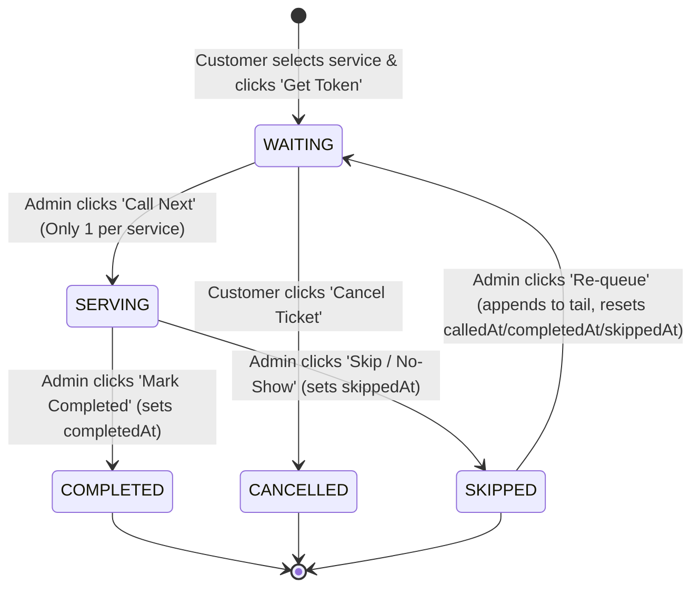

# Software Requirements Specification (SRS)
## Project: QueueLess — Smart Queue Management & Waiting-Time Estimation Web Application
**Academic Context:** Semester 3 CSE (AI/ML) End Semester Examination (ESE)  
**Author / Candidate:** Student (Pair-programmed with AI Architect)  
**Version:** 1.2.0 (Post-QA Review & Decision Lock)  
**Date:** October 2026  
**Status:** Requirements & Architecture Approved for Implementation  

---

## 1. Executive Summary & Problem Analysis

### 1.1 Problem Statement
Physical waiting lines at service counters (university student service desks, outpatient triage, fees/cashier counters) suffer from three critical operational deficiencies:
1. **Total Invisibility:** Visitors cannot determine how many people precede them or how fast the counter is progressing.
2. **Waiting Anxiety & Lost Productivity:** Without a reliable wait estimate, visitors cannot budget their time or leave the physical counter area.
3. **Operational Friction:** Service staff manually call numbers, manage crowd congestion, and lack real-time visibility into incoming load.

### 1.2 Proposed Solution & Prototype Boundary
**QueueLess** is a zero-cost, lightweight, browser-based web application prototype designed to demonstrate effective prompt engineering, state machine modeling, and algorithmic queue estimation for a Semester 3 CSE (AI/ML) examination.
- **Customer View (Mobile-First):** Service selection, instant virtual token generation, live queue position, and dynamic wait-time display.
- **Administrator Dashboard (Desktop/Tablet):** Counter controls (Call Next, Complete, Skip, Re-queue), live queue monitoring, and counter throughput metrics.
- **Client-Side Architecture:** Zero cloud/server dependency; state persists in browser `localStorage` and synchronizes across browser tabs via `BroadcastChannel`.

---

## 2. Requirement Classification & Scope Control

To guarantee delivery within academic evaluation constraints while maintaining architectural rigor, all features are strictly categorized:

| Category | Definition | Included Features |
| :--- | :--- | :--- |
| **Must-Have MVP** | Non-negotiable core functionality required for initial prototype validation. | 1. Service Catalog & Selection (Admissions, Finance, Records)<br>2. Sequential Token Generation (`<PREFIX>-<NUM>`)<br>3. Displayed Queue Position & Waiting Tokens Ahead<br>4. Stage A (Baseline) Waiting-Time Estimation<br>5. Live Digital Ticket Tracker & Status Badge<br>6. Counter Admin Dashboard<br>7. Admin Dispatcher: "Call Next", "Mark Complete", "Skip"<br>8. Browser LocalStorage Persistence across reloads<br>9. Responsive Design (Mobile customer view, desktop admin view)<br>10. Invalid Action Prevention (Empty queue guard, duplicate active token prevention) |
| **Recommended Enhancements** | High-value additions to be built immediately following MVP verification. | 1. Stage B: Simple Rolling Average Service Duration (last 5 completed tokens)<br>2. Cross-Tab Live Sync via `BroadcastChannel` with `storage` fallback<br>3. Service Pause/Resume toggle<br>4. Admin Skipped-Token Re-queue action (appends to tail)<br>5. Admin 1-Click Demo Data Seeder & Queue Reset for viva demonstration |
| **Optional Features (Post-MVP)** | Preserved design concepts explicitly deferred from initial implementation. | 1. Stage C: Blended Historical Estimate with dynamic remaining-time countdown<br>2. Audio Chime / Sound Alert on "Now Serving"<br>3. Dark/Light Mode Theme Switcher<br>4. Simulated SMS/Email Notification Banner |

---

## 3. Approved Service Catalog & Configuration

The following three service categories are formally locked for the application:

| Service Name | Code Prefix | Baseline Service Duration ($T_{\text{baseline}}$) | Description |
| :--- | :---: | :---: | :--- |
| **Admissions & Document Verification** | `ADM` | 5 minutes | Academic certificate verification, enrollment formalities. |
| **Finance & Fee Clearance** | `FIN` | 3 minutes | Tuition payment receipts, challan verification, dues clearance. |
| **Examinations & Records** | `EXM` | 6 minutes | Transcript issuance, grade card verification, duplicate IDs. |

---

## 4. Technical Architecture & Cross-Tab Concurrency

### 4.1 System Topology
```mermaid
graph TD
    subgraph Browser Environment
        subgraph Customer Tab (Mobile View)
            UI_Customer[Customer View: Join & Tracker]
            Hook_Cust[useQueue Hook]
            UI_Customer --> Hook_Cust
        end
        
        subgraph Admin Tab (Desktop View)
            UI_Admin[Admin Dashboard & Controls]
            Hook_Admin[useQueue Hook]
            UI_Admin --> Hook_Admin
        end

        Hook_Cust <--> StateEngine[Client-Side State Engine & Validation]
        Hook_Admin <--> StateEngine

        StateEngine --> EstEngine[Wait-Time Estimation Engine (Stage A/B)]
        StateEngine <--> StorageAdapter[LocalStorage Adapter (Schema & Version Check)]
        StorageAdapter <--> LocalStore[(browser localStorage)]

        StateEngine -.->|Notify Action| BC[BroadcastChannel: 'queueless_sync']
        BC -.->|Reload Event| Hook_Cust
        BC -.->|Reload Event| Hook_Admin
    end
```

### 4.2 Cross-Tab Consistency Strategy & Concurrency Limitations
> [!IMPORTANT]
> **Academic Transparency on Concurrency Limits:**  
> In a purely client-side browser environment without a backend server or transactional database, neither `localStorage` nor `BroadcastChannel` provides atomic Compare-And-Swap (CAS), mutexes, or ACID transaction guarantees. If two browser tabs execute write operations to `localStorage` at the exact same millisecond, the second write simply overwrites the first (last-write-wins). The techniques below provide a **practical, best-effort synchronization mechanism** suitable for prototype simulation, and make no claims of production-grade distributed concurrency control.

#### Practical Prototype Synchronization Strategy:
1. **Single-Mutator Preferred Role Assignment:** In standard operation, the Admin tab performs counter status mutations (`WAITING` $\to$ `SERVING` $\to$ `COMPLETED` / `SKIPPED`), while the Customer tab primarily performs read operations and issues single token creations (`NEW` $\to$ `WAITING`) or cancellations (`WAITING` $\to$ `CANCELLED`).
2. **Defensive Precondition Validation:** Before any state transition is committed to `localStorage`, the engine re-reads the latest state and verifies target preconditions:
   - "Call Next" is executed only if the target token is still in `WAITING` status and no other token is currently `SERVING` for that service.
   - If an unexpected state is detected (e.g., token already cancelled by user), the transition aborts gracefully with a notification.
3. **Monotonic State Versioning:** Every storage commit increments an integer `stateVersion` and logs `lastUpdatedAt: Date.now()`.
4. **Broadcast-Triggered Canonical Reload:** When any tab mutates state, it broadcasts `{ type: 'QUEUE_UPDATED', version: stateVersion }`. Receiving tabs refresh their in-memory React state directly from the canonical `localStorage` copy.
5. **UI Debouncing & Disabling:** Action buttons ("Call Next", "Complete", "Get Token") are disabled immediately upon click until the local state commit completes, preventing accidental double-submissions.

---

## 5. Token Data Schema & State Machine (FSM)

### 5.1 Token Data Schema
```typescript
interface Token {
  id: string;                    // Unique identifier (e.g. "tok_1730210000000_adm1")
  tokenNumber: string;           // Formatted sequential display (e.g. "ADM-001")
  serviceId: string;             // Service key: 'admissions' | 'finance' | 'examinations'
  serviceName: string;           // Display title
  customerName?: string;         // Optional customer identifier
  status: 'WAITING' | 'SERVING' | 'COMPLETED' | 'SKIPPED' | 'CANCELLED';
  createdAt: number;             // Timestamp (epoch ms) when token was generated
  calledAt: number | null;        // Timestamp (epoch ms) when moved to SERVING
  completedAt: number | null;     // Timestamp (epoch ms) set ONLY when COMPLETED
  skippedAt: number | null;       // Timestamp (epoch ms) set ONLY when SKIPPED
  estimatedWaitMinutes: number;  // Snapshot of estimated wait at generation
  requeueCount: number;          // Number of times token has been re-queued (default: 0)
}
```

### 5.2 Finite State Machine (FSM)


### 5.3 Skipped-Token Accounting & Re-queue Semantics
1. **Timestamp Exclusivity:**
   - When a token transitions to `COMPLETED`, `completedAt` is recorded, and `skippedAt` remains `null`.
   - When a token transitions to `SKIPPED`, `skippedAt` is recorded, and `completedAt` remains `null`.
2. **Exclusion from Rolling Averages:**
   - Tokens in `SKIPPED` status are **strictly excluded** from Stage B rolling-average calculations because an absentee customer does not represent completed service duration.
3. **Re-queue Fairness Rule:**
   - When staff clicks **"Re-queue"** on a skipped ticket:
     - `status` reverts to `WAITING`.
     - `calledAt`, `completedAt`, and `skippedAt` are reset to `null`.
     - `createdAt` is reassigned to `Date.now()`, appending the token to the **tail of the waiting line**.
     - `requeueCount` increments by 1.
   - *Academic Rationale:* This guarantees queue fairness; a customer who missed their turn cannot jump ahead of other customers who have waited patiently.

---

## 6. Queue Position & Waiting-Time Estimation Model

### 6.1 Definitions and Metrics Consistency
To completely eliminate ambiguity between position, depth, and duration:

1. **Waiting Tokens Ahead ($N_{\text{ahead}}$):**
   The exact count of other tokens in `WAITING` status preceding token $T$ within the same service:
   $$N_{\text{ahead}}(T) = \big|\{ T_i \mid \text{serviceId}(T_i) = \text{serviceId}(T) \land \text{status}(T_i) = \text{'WAITING'} \land \text{createdAt}(T_i) < \text{createdAt}(T) \}\big|$$

2. **Displayed Queue Position ($P$):**
   The human-readable ordinal place in line:
   $$P(T) = \begin{cases}
   \text{"Now Serving"} & \text{if } \text{status}(T) = \text{'SERVING'} \\
   N_{\text{ahead}}(T) + 1 & \text{if } \text{status}(T) = \text{'WAITING'} \\
   \text{"N/A"} & \text{if } \text{status}(T) \in \{\text{'COMPLETED'}, \text{'SKIPPED'}, \text{'CANCELLED'}\}
   \end{cases}$$

3. **Estimated Waiting Time ($\text{EstimatedWait}$):**
   The projected waiting time in integer minutes until token $T$ is called to the counter.

---

### 6.2 The Unambiguous Two-Branch Waiting-Time Model

$$\text{EstimatedWait}(T) = \begin{cases}
\text{RemainingCurrentService} + \left(N_{\text{ahead}}(T) \times \text{EstimatedServiceDuration}\right) & \text{if a token is currently being served} \\
N_{\text{ahead}}(T) \times \text{EstimatedServiceDuration} & \text{if no token is currently being served}
\end{cases}$$

Where:
- $\text{EstimatedServiceDuration}$ is defined by the active implementation stage (Stage A or Stage B).
- $\text{RemainingCurrentService}$ is the estimated time left for the active counter customer:
  $$\text{ElapsedServingTime} = \max\left(0, \frac{\text{Date.now}() - \text{calledAt}(T_{\text{serving}})}{60000}\right)$$
  $$\text{RemainingCurrentService} = \max\left(0, \text{EstimatedServiceDuration} - \text{ElapsedServingTime}\right)$$

#### Clarification on Estimated Wait of Zero & Next-In-Line Display:
> [!NOTE]
> **Interpretation of Estimated Wait = 0:**  
> An estimated wait time of **0 minutes** represents **queue wait time before being called to the counter** ($\text{Wait}_{\text{queue}}$), NOT total service completion time. It explicitly signifies that the counter is currently vacant and ready to call the customer immediately. It does **not** guarantee immediate transaction completion.

#### Standardized UI State Wording:
| Queue Condition | Displayed Position ($P$) | Waiting Ahead ($N_{\text{ahead}}$) | UI Status Banner / Wording | Estimated Wait Text |
| :--- | :---: | :---: | :--- | :--- |
| **No active serving token, user is head of queue** | `#1 (Next)` | `0` | **"You are next in line — Counter is ready to call you"** | `0 min (Ready now)` |
| **Token currently serving, user is next waiting** | `#1 in line` | `0` | **"You are next in line — Please remain near counter"** | `~X min (Until call)` |
| **Multiple tokens waiting ahead** | `#P in line` | `$N_{\text{ahead}}$` | **"Position #P — N waiting tokens ahead of you"** | `~Y min estimated` |
| **Token called by staff** | `Now Serving` | `0` | **"Now Serving — Please proceed to counter"** | `At Counter` |

---

### 6.3 Staged Implementation of Estimation Complexity

#### Stage A: Baseline Service-Time Model (Must-Have MVP)
- **Concept:** Static baseline duration configured per service: Admissions (5 min), Finance (3 min), Records (6 min).
- **Formula:** $\text{EstimatedServiceDuration} = T_{\text{baseline}}$.
- **Approval Status:** Formally approved for initial MVP implementation.

#### Stage B: Simple Rolling Average Model (Recommended Enhancement)
- **Concept:** Unweighted arithmetic mean (simple rolling average) of the last $M \le 5$ completed tokens for that service.
- **Formula:**
  $$\text{EstimatedServiceDuration} = \begin{cases}
  T_{\text{baseline}} & \text{if } M = 0 \\
  \frac{1}{M} \sum_{j=1}^{M} D_j & \text{if } M > 0
  \end{cases}$$
  Where $D_j = \text{clamp}\left(\frac{\text{completedAt}(T_j) - \text{calledAt}(T_j)}{60000}, 1.0, 20.0\right)$.
- **Strict Constraint:** Considers **ONLY tokens with `status === 'COMPLETED'`** having valid non-null timestamps. Tokens with `status === 'SKIPPED'` are strictly excluded.
- **Approval Status:** Approved to be added only after core MVP features pass acceptance testing.

#### Stage C: Baseline-Blended Historical Model (Optional / Post-MVP)
- **Concept:** Weighted combination of baseline and rolling average ($\hat{D} = 0.3 T_{\text{baseline}} + 0.7 \bar{D}$).
- **Approval Status:** Preserved as a future enhancement; excluded from initial phases.

---

## 7. Numerical Validation Test Examples

*Reference service: Admissions ($T_{\text{baseline}} = 5 \text{ minutes}$).*

### Example 1: Empty Queue (Initial Arrival)
- **State:** No token serving. No tokens waiting. User A joins $\to$ `ADM-001`.
- **Calculations:**
  - Token serving: None $\implies \text{Branch 2}$.
  - $N_{\text{ahead}} = 0$.
  - Displayed Position $P = \mathbf{\#1 \text{ (Next in line)}}$.
  - Estimated Wait $= 0 \times 5 = \mathbf{0 \text{ minutes}}$ *(Counter is ready to call immediately).*

### Example 2: Active Serving Token, Zero Waiting Ahead
- **State:** `ADM-001` called 2 minutes ago ($\text{Remaining} = 3 \text{ min}$). User B joins $\to$ `ADM-002`.
- **Calculations:**
  - Token serving: `ADM-001` $\implies \text{Branch 1}$.
  - $\text{RemainingCurrentService} = \max(0, 5 - 2) = 3 \text{ minutes}$.
  - $N_{\text{ahead}} = 0$.
  - Displayed Position $P = \mathbf{\#1 \text{ in waiting line}}$.
  - UI Wording: *"You are next in line — Please remain near counter"*.
  - Estimated Wait $= 3 + (0 \times 5) = \mathbf{3 \text{ minutes}}$.

### Example 3: Multiple Waiting Tokens
- **State:** `ADM-001` is serving ($\text{Remaining} = 4 \text{ min}$). Waiting in queue: `ADM-002`, `ADM-003`, `ADM-004`. User E joins $\to$ `ADM-005`.
- **Calculations:**
  - Token serving: `ADM-001` ($\text{Remaining} = 4 \text{ min}$).
  - Waiting ahead: `ADM-002`, `ADM-003`, `ADM-004` $\implies N_{\text{ahead}} = 3$.
  - Displayed Position $P = 3 + 1 = \mathbf{\#4 \text{ in waiting line}}$.
  - Estimated Wait $= 4 + (3 \times 5) = \mathbf{19 \text{ minutes}}$.

### Example 4: Token Completion & Advancing Queue
- **State Transition:** Staff completes `ADM-001` (service duration: 4 minutes, recorded in `completedAt`) and calls `ADM-002` ($\text{calledAt} = \text{Now}$, $\text{Remaining} = 5 \text{ min}$).
- **Calculations for `ADM-005`:**
  - Token serving: `ADM-002` ($\text{Remaining} = 5 \text{ min}$).
  - Waiting ahead: `ADM-003`, `ADM-004` $\implies N_{\text{ahead}} = 2$.
  - Displayed Position $P = 2 + 1 = \mathbf{\#3 \text{ in waiting line}}$.
  - Stage A Estimated Wait $= 5 + (2 \times 5) = \mathbf{15 \text{ minutes}}$.

### Example 5: Token Skipped / Absentee Handling
- **State Transition:** Staff calls `ADM-003`. Customer is absent. Staff clicks "Skip / No-Show" (`skippedAt` recorded, `completedAt = null`). Staff immediately calls `ADM-004` ($\text{Remaining} = 5 \text{ min}$).
- **Calculations for `ADM-005`:**
  - Token serving: `ADM-004` ($\text{Remaining} = 5 \text{ min}$).
  - Waiting ahead: None $\implies N_{\text{ahead}} = 0$.
  - Displayed Position $P = 0 + 1 = \mathbf{\#1 \text{ (Next in line)}}$.
  - Estimated Wait $= 5 + (0 \times 5) = \mathbf{5 \text{ minutes}}$.
  - *Accounting Verification:* `ADM-003` does **not** contribute to Stage B rolling average.

---

## 8. Business Rules & Operational Policies

1. **Token Numbering:** Monotonic per-service sequential numbering (`ADM-001`, `FIN-001`) persisting across reloads, resetting only via explicit Admin Reset.
2. **Single-Token Session Constraint:** A customer browser session is restricted to holding at most **one active token** (`WAITING` or `SERVING`) at any given time.
3. **Skipped-Token Recall:** Re-queueing appends the ticket to the **tail** of the waiting line (`createdAt = Date.now()`) with timestamps reset, preserving queue fairness.
4. **Paused Counter Policy:** Admin can toggle `PAUSED`, disabling new token generation while honoring existing waiting tickets.
5. **Demo Data Seeding:** Dedicated Admin button generates a standardized viva demonstration scenario (1 serving, 4 waiting, 2 completed).

---

## 9. Comprehensive Acceptance Criteria (Given-When-Then)

- **AC-01 (Service Catalog):** Given an unqueued visitor, When visiting `/`, Then all 3 services display their title, prefix, and live waiting count.
- **AC-02 (Token Generation):** Given a selected service, When clicking "Get Token", Then a sequential token is created in `localStorage` and routes to `/tracker`.
- **AC-03 (Single Active Token):** Given a user holding an active token, When visiting `/`, Then the user is automatically redirected to `/tracker`.
- **AC-04 (Position & Ahead Count):** Given a token with 2 waiting tokens ahead, When viewing tracker, Then it displays "Position: #3 in line" and "2 waiting tokens ahead of you".
- **AC-05 (Wait Estimation):** Given $N_{\text{ahead}} = 2$ on Admissions (5 min) with 3 min left on serving token, When rendered, Then estimated wait is $3 + (2 \times 5) = 13 \text{ min}$.
- **AC-06 (Zero Wait Meaning):** Given $N_{\text{ahead}} = 0$ and no token serving, When rendered, Then estimated wait displays "0 min (Ready now)" and status displays "Counter is ready to call you".
- **AC-07 (Now Serving Alert):** Given a user's token is called, When updated to `SERVING`, Then the badge turns Vibrant Green and displays "Now Serving — Please proceed to counter".
- **AC-08 (Admin Dispatch):** Given waiting tokens exist and counter is vacant, When staff clicks "Call Next", Then the highest priority token becomes `SERVING`.
- **AC-09 (Empty Queue Guard):** Given 0 waiting tokens, When staff views "Call Next", Then button is disabled and displays "Queue is empty" on click attempt.
- **AC-10 (Completion Accounting):** Given a serving token, When staff clicks "Mark Completed", Then `completedAt` is recorded, `skippedAt` is null, and serving slot clears.
- **AC-11 (Skip Accounting):** Given a serving token, When staff clicks "Skip / No-Show", Then `skippedAt` is recorded, `completedAt` is null, and token is excluded from rolling averages.
- **AC-12 (Re-queue to Tail):** Given a skipped token, When staff clicks "Re-queue", Then token moves to `WAITING`, timestamps reset, and it is appended to the tail.
- **AC-13 (Persistence Across Reload):** Given an active token, When reloading the browser tab, Then all state, position, and elapsed times are restored accurately.
- **AC-14 (Responsive Layout):** Given viewport width 375px (mobile), When viewing customer tracker, Then UI renders as a single centered card without horizontal scroll.
